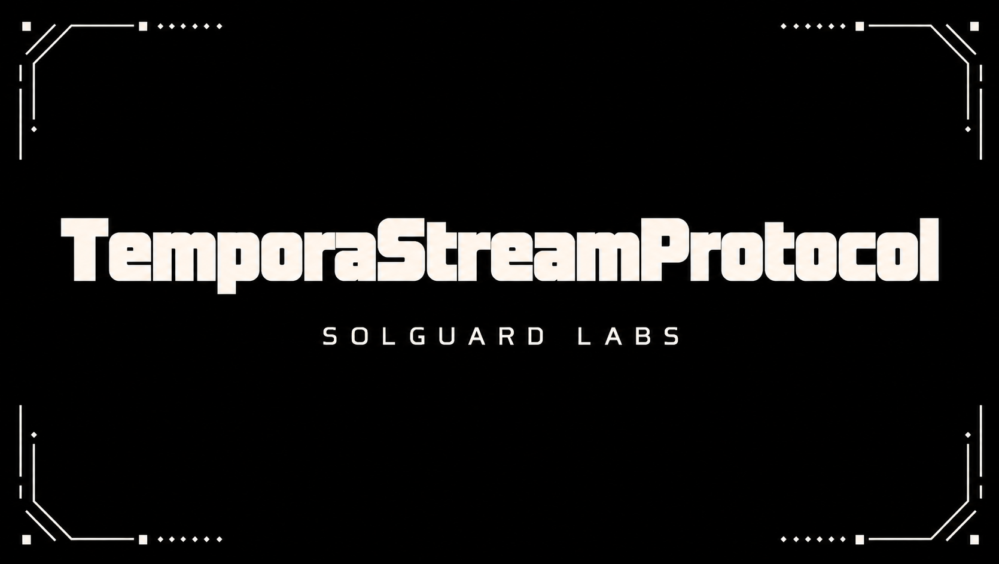
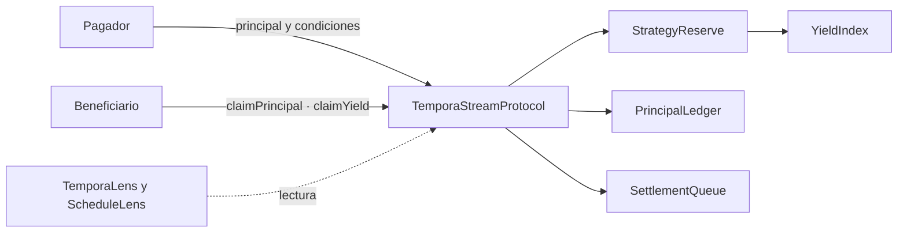
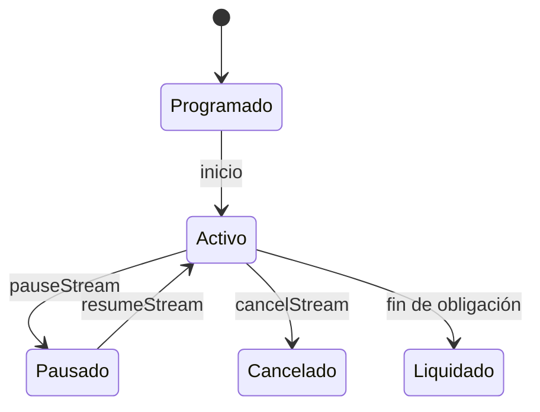

# TemporaStreamProtocol



TemporaStreamProtocol es un protocolo de pagos continuos respaldados por
depositos productivos. Un pagador bloquea principal para un beneficiario y el
derecho de cobro se acumula segundo a segundo durante la ventana activa del
stream. El principal no vencido permanece dentro de una reserva productiva que
mantiene un indice de rendimiento por activo.



## Componentes

- `TemporaStreamProtocol`: coordinador de streams, pausas, reanudaciones,
  reclamaciones y reservas por activo.
- `StrategyReserve`: custodia interna de principal, buffer de rendimiento y
  creditos liberados para pagadores.
- `YieldIndex`: acumulador temporal usado para atribuir rendimiento a streams
  abiertos.
- `PrincipalLedger`, `ReserveMath` y `StreamRiskModel`: librerias de consulta,
  salud de reservas y scoring operativo.
- `TemporaLens`: contrato de lectura para agregados de cuenta y reserva.
- `TemporaScheduleLens`: proyección acotada de principal futuro y reclamable
  actual para un stream, sin ejecutar pagos.
- `MockERC20`: activo de pruebas para la suite Foundry.

## Requisitos

- Foundry estable instalado y disponible en `PATH`.
- Solidity `0.8.26`, configurado en `foundry.toml`.

## Uso Local

```bash
forge build
forge test
```

Los scripts reproducibles son:

```bash
bash scripts/tests.sh
bash scripts/ci.sh
```

En Windows puede invocarse `forge.exe build` y `forge.exe test` desde PowerShell.

## Flujo Del Protocolo

1. El gestor habilita una reserva para un token y define su tasa de indice.
2. El pagador aprueba el token y crea un stream con beneficiario, tasa por
   segundo, inicio y vencimiento.
3. El beneficiario reclama principal acumulado durante ventanas activas.
4. Los participantes pueden pausar y reanudar streams cuando existe una ventana
   operativa sin servicio.
5. El principal no devengado se libera como credito retirable para el pagador.
6. El rendimiento reportado por la reserva se distribuye mediante el indice del
   activo.

Para un stream de `1 token/segundo` durante `1 000 segundos`, el principal
reservado es `1 000 tokens`. Tras `120 segundos` activos, el beneficiario puede
reclamar `120`; el resto sigue sujeto al estado del stream. La vista
`TemporaScheduleLens.project(streamId, 90)` estima el principal incremental de
una ventana futura de 90 segundos, limitado por el saldo y por el vencimiento.



## CI

GitHub Actions ejecuta:

- `forge fmt --check`
- `forge build`
- `forge test`

Dependabot cubre las acciones de GitHub usadas por el workflow.

## Estructura

```text
src/
  access/
  accounting/
  core/
  interfaces/
  lens/
  libraries/
  mocks/
  policy/
  settlement/
  tokens/
tests/
scripts/
.github/
.vscode/
```

## Estado

La versión `v1.0.0` fija un estado verificable de `main`, `production` y tag
anotado. El nombre de la rama no implica despliegue en una red pública ni
custodia de activos externos.

Consultar [arquitectura](./docs/arquitectura.md), [economía](./docs/modelo-economico.md),
[integración](./docs/integracion.md) y [operación](./docs/operacion.md).
