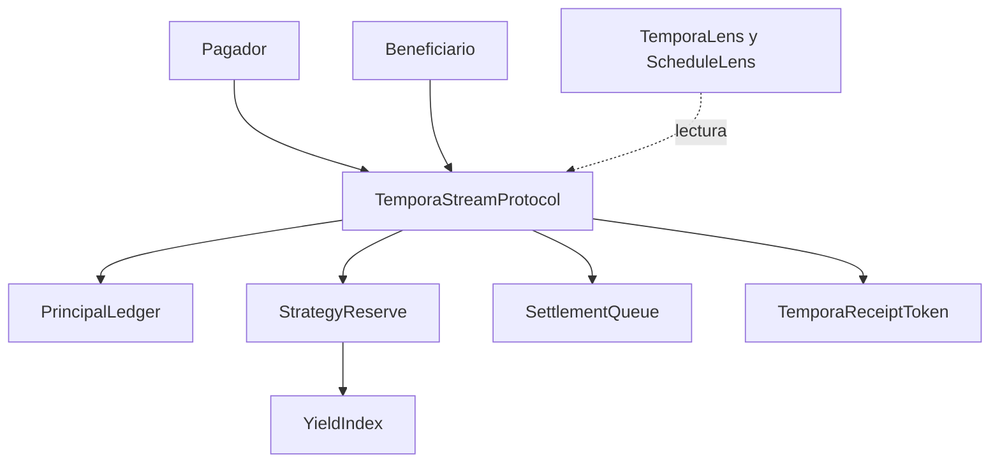

# Arquitectura de pagos continuos

Un stream vincula pagador, beneficiario, token, tasa, inicio y vencimiento. `TemporaStreamProtocol` coordina los cambios de estado; `StrategyReserve` conserva el escrow y un buffer de rendimiento; `PrincipalLedger` calcula principal devengado. `YieldIndex` mantiene el índice por activo. Los contratos de lectura no tienen permisos de retiro.

Las transiciones principales son creación, activación, pausa, reanudación, cancelación y liquidación. Cada transición conserva un nonce y eventos observables. Un integrador debe registrar bloque y estado de la lectura; no debe asumir que un stream anunciado o pausado genera obligaciones al mismo ritmo que uno activo.
