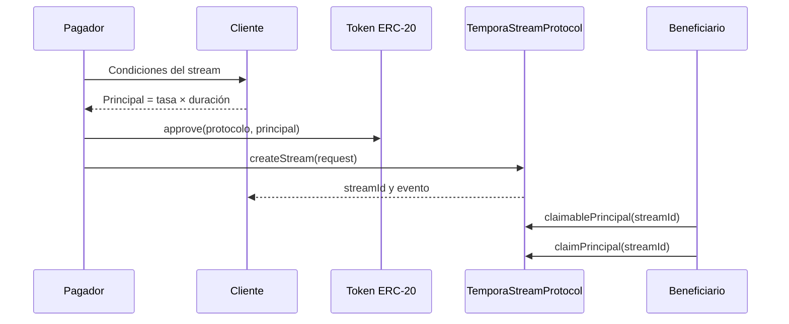

# Integración de pagadores y beneficiarios

La creación requiere dirección del token, beneficiario, inicio, vencimiento, tasa, reserva mínima, permiso de cancelación y hash de metadatos. El pagador aprueba primero el principal calculado y llama `createStream`. El beneficiario consulta `claimablePrincipal` y `claimableYield` antes de cada reclamación.

`TemporaScheduleLens.project(protocol, streamId, horizonSeconds)` acepta un horizonte de 1 segundo a 30 días. Devuelve el estado, ventana efectiva, principal incremental estimado, reclamable actual y saldo remanente. Una pausa devuelve incremento cero; la proyección no ejecuta pagos ni anticipa futuras decisiones de participantes.

Errores operativos: aprobación insuficiente, token no configurado, beneficiario inválido, duración fuera de política, estado incompatible o reserva no habilitada. Tras una reversión, reconsultar `streamOf` y la reserva antes de reintentar.
