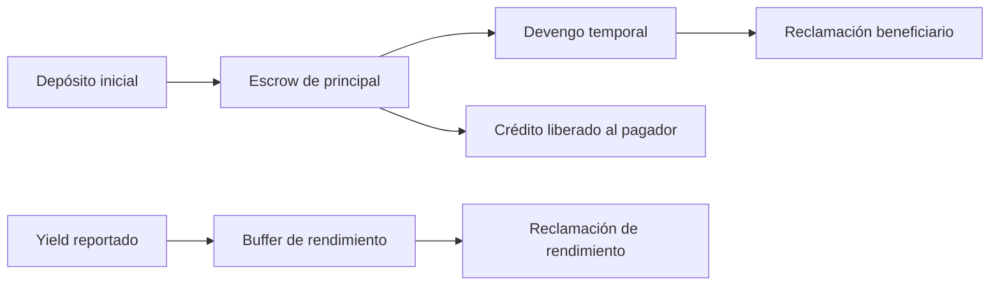

# Modelo económico y unidades

El principal financiado es `tasaPorSegundo × (fin − inicio)`. Con tasa de `1 tUSD/s` y duración `1 000 s`, el pagador deposita `1 000 tUSD`. El principal devengado se materializa en las ventanas habilitadas; una reclamación reduce el balance del stream y el escrow de la reserva.

El índice global crece por `tasaÍndice × segundos` y permite expresar rendimiento sobre una base productiva. La reserva contabiliza por separado `totalEscrowed`, `yieldBuffer`, `paidFromYield` y `paidFromPrincipal`; la reconciliación operativa debe comprobar cada origen de pago. Un cambio de tasa del índice afecta las lecturas posteriores, no el principal contractual del stream.

Los importes se expresan en unidades nativas del token, mientras el índice usa una escala de `1e18`. El redondeo entero puede dejar cantidades residuales; no presentar una estimación de vista como importe garantizado de liquidación futura.
