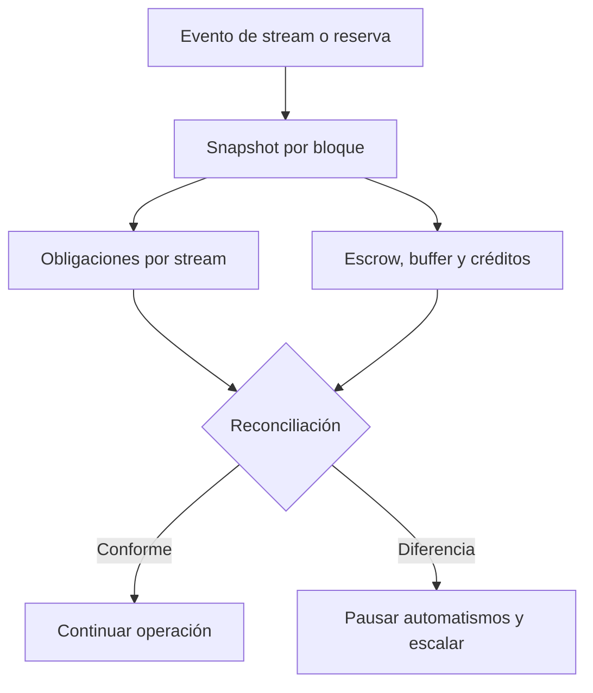

# Operación y reconciliación

Registrar por activo el escrow, principal productivo, buffer de rendimiento, crédito liberado y pagos acumulados. Los operadores de reserva deben cotejar eventos con saldos ERC-20 y con los estados de stream por bloque. La suma de obligaciones no puede inferirse de un único campo de vista.

Para una pausa o cancelación, registrar actor, instante, estado anterior, principal devengado, principal liberado y saldo resultante. Para un reporte de rendimiento, registrar origen, importe y variación del buffer. Las decisiones correctivas deben ser revisadas por una segunda persona con permisos separados.

`bash scripts/ci.sh` reproduce formato, compilación y tests; las pruebas locales usan `MockERC20`. No hay configuración de despliegue en red pública ni activos de terceros en esta entrega.
